# Sistema de Gestión de Estudiantes (SGE) básico

**Estudiante** — Edison Monsalve  
**Materia** — ALGORITMOS Y PROGRAMACIÓN  
**Grupo** — PENDIENTE  
**Fecha de entrega** — 11 de noviembre de 2026  
**Profesora** — Ingeniera Eliana Marcela Páez Perdomo

## Introducción

El sistema SGE permite registrar hasta cinco estudiantes (límite que puse por ser pruebas), mostrar la lista completa y consultar un registro por su ID. 

Cada registro incluye el ID, el nombre, la edad, la carrera, las tres notas y la nota final. 

El programa se ejecuta por consola con Python y guarda los datos en una lista durante la ejecución.

## Reglas del sistema

- El usuario ingresa un ID ficticio compuesto por letras o números. El programa lo convierte a mayúsculas para que DVV007 y dvv007 se reconozcan como el mismo ID - parte de una función usada para mejorar el software (la profe solicitó en el PDF mejoras)  ;-) 
- El nombre y la carrera son obligatorios. La edad debe ser un número entero entre 15 y 90, inclusive.
- Cada nota debe estar entre 0.0 y 5.0. La nota final se calcula con los pesos de 30 %, 30 % y 40 % y se muestra con dos decimales.
- Si una opción del menú o un dato del registro es inválido, se muestra el motivo y se regresa al menú. La lista solo cambia cuando el registro está completo (producto del análisis propio, ignoro si era necesario otro comportamiento)
- La pantalla del menú muestra el número de estudiantes registrados. Al cerrar el programa se pierden los registros.

## Cómo ejecutar el programa

Abre una terminal en esta carpeta y ejecuta `python sge.py`.

## Estructuras de control

| Estructura | Uso                                                     | Justificación                                                                                                                                                  |
| ---------- | ------------------------------------------------------- | -------------------------------------------------------------------------------------------------------------------------------------------------------------- |
| while      | Repetir el menú mientras la bandera de salida sea falsa | La cantidad de opciones que elegirá el usuario se desconoce.                                                                                                   |
| match/case | Ejecutar la operación asociada con la opción del menú   | Cada opción tiene un valor fijo y una acción distinta.                                                                                                         |
| if         | Validar cupo, datos y coincidencias de ID               | La acción depende de si se cumple una condición.                                                                                                               |
| for        | Recorrer la lista al mostrarla y al buscar un ID        | Permite revisar cada registro y terminar la búsqueda al encontrar una coincidencia.                                                                            |
| try/except | Convertir la edad y las notas a números                 | Permite mostrar un mensaje cuando el usuario escribe un valor que no se puede convertir.<br><br>Esto es básicamente la mejor forma para catchTURAR los errores |

Una lista de diccionarios mantiene juntos los datos de cada estudiante. 

El contador se actualiza con el tamaño de la lista después de agregar un registro. 

La función de búsqueda se reutiliza para detectar duplicados y para consultar un ID. 

Una misma función muestra la ficha tanto en el listado como en la búsqueda.

## Casos de prueba y evidencias

La validación inicial del flujo contempla un registro correcto que vuelve al menú con el contador en uno, un registro rechazado que conserva el contador y la opción de salida que termina el ciclo.

| Caso              | Entrada o acción                                                         | Resultado esperado                                           |
| ----------------- | ------------------------------------------------------------------------ | ------------------------------------------------------------ |
| Lista vacía       | Mostrar al iniciar                                                       | Mensaje que indica que no hay estudiantes.                   |
| Registro correcto | DVV007, Edison Monsalve, 52, Diseño Visual Virtual, notas 4.0, 5.0 y 4.5 | El contador cambia de 0 a 1 y la nota final es 4.50.         |
| ID repetido       | Agregar dvv007                                                           | Se informa que el ID ya existe y se conserva el contador.    |
| Edad inválida     | Probar con texto o con 14 años                                           | Se indica el error y el registro no se agrega.               |
| Nota inválida     | Ingresar 5.1 en una nota                                                 | Se indica el error y el registro no se agrega.               |
| Listado           | Agregar cinco registros válidos y mostrar todos                          | Se muestran las cinco fichas.                                |
| Búsqueda exitosa  | Buscar dvv007                                                            | Se muestra la ficha de Edison Monsalve.                      |
| Búsqueda fallida  | Buscar DVV999                                                            | Se informa que no se encontró el ID.                         |
| Cupo lleno        | Completar cinco registros e intentar agregar otro                        | Se indica que se alcanzó el cupo y el total sigue en cinco.  |
| Menú y salida     | Ingresar una opción inválida y después elegir salir                      | El menú se repite tras el error y luego el programa termina. |

La prueba de consola confirmó los resultados de la tabla. También se aceptaron los límites de edad de 15 y 90 años y las notas de 0.0 y 5.0. 

Las imágenes y los resultados de cada prueba se incluyen en el anexo de evidencias (al final, profe)

## Análisis y reflexión

La búsqueda revisa los registros en el orden en que se agregaron. 

Si el ID está al principio, termina con la primera coincidencia. 

Si está al final o no existe, puede revisar hasta cinco registros. 

La dificultad principal es comprobar todos los datos antes de guardar la ficha. 

Guardarla al final del registro mantiene el contador y la lista sincronizados incluso cuando alguna entrada falla.

## Diagrama de flujo completo

El menú principal se lee de arriba hacia abajo. Los diagramas de cada opción amplían sus pasos. Al terminar de agregar, mostrar o buscar, el programa vuelve al menú.

| Símbolo | Uso en el programa |
| --- | --- |
| Óvalo | Inicio, fin o regreso al menú desde una operación |
| Rectángulo | Proceso, como calcular una nota o guardar la ficha |
| Rombo | Decisión, como comprobar si queda cupo |
| Paralelogramo | Entrada o salida, como leer un ID o mostrar una ficha |
| Rectángulo con doble borde | Operación que se explica en un diagrama aparte |

### Menú principal

~~~mermaid
flowchart TD
    Inicio([Inicio]) --> Preparar["Lista vacía, contador en 0<br/>y bandera de salida falsa"]
    Preparar --> Ciclo{"¿Salir?"}
    Ciclo -- Sí --> Fin([Fin])
    Ciclo -- No --> Menu[/"Mostrar menú y contador.<br/>Leer opción"/]
    Menu --> Opcion{"¿Qué opción?"}
    Opcion -- 1 --> Agregar[["Agregar"]]
    Opcion -- 2 --> Mostrar[["Mostrar todos"]]
    Opcion -- 3 --> Buscar[["Buscar por ID"]]
    Opcion -- 4 --> Despedida[/"Mostrar despedida"/]
    Despedida --> Bandera["Activar bandera"]
    Opcion -- Otra --> Error[/"Opción inválida"/]
    Agregar --> Volver["Continuar el ciclo"]
    Mostrar --> Volver
    Buscar --> Volver
    Error --> Volver
    Bandera --> Volver
    Volver --> Ciclo
~~~

### Agregar estudiante

Cada validación se realiza al recibir el dato correspondiente. Si falla una, el programa muestra el motivo y vuelve al menú sin guardar la ficha.

~~~mermaid
flowchart TD
    Inicio([Agregar]) --> Cupo{"¿Hay cupo?"}
    Cupo -- Sí --> ID[/"Leer ID"/]
    ID --> ValidarID{"¿ID alfanumérico<br/>y disponible?"}
    ValidarID -- Sí --> Datos[/"Leer nombre, carrera y edad"/]
    Datos --> ValidarDatos{"¿Datos válidos?"}
    ValidarDatos -- Sí --> Nota[/"Leer la siguiente nota"/]
    Nota --> ValidarNota{"¿Número entre 0 y 5?"}
    ValidarNota -- Sí --> GuardarNota["Guardar nota"]
    GuardarNota --> Tres{"¿Ya hay tres notas?"}
    Tres -- No --> Nota
    Tres -- Sí --> Registro["Calcular la nota final<br/>y agregar la ficha"]
    Registro --> Confirmar[/"Confirmar registro"/]
    Cupo -- No --> Error[/"Mostrar el motivo del error"/]
    ValidarID -- No --> Error
    ValidarDatos -- No --> Error
    ValidarNota -- No --> Error
    Confirmar --> Volver([Volver al menú])
    Error --> Volver
~~~

El ID se compara en mayúsculas con la misma búsqueda que usa la opción 3. El nombre y la carrera deben tener contenido. La edad debe ser un entero entre 15 y 90. Al volver al menú, el contador toma el tamaño actual de la lista.

### Mostrar todos

~~~mermaid
flowchart TD
    Inicio([Mostrar todos]) --> Vacia{"¿Lista vacía?"}
    Vacia -- Sí --> Aviso[/"Informar que no hay estudiantes"/]
    Vacia -- No --> Pendiente{"¿Queda una ficha por mostrar?"}
    Pendiente -- Sí --> Ficha[/"Mostrar ficha y avanzar"/]
    Ficha --> Pendiente
    Pendiente -- No --> Volver([Volver al menú])
    Aviso --> Volver
~~~

### Buscar por ID

~~~mermaid
flowchart TD
    Inicio([Buscar]) --> ID[/"Leer ID"/]
    ID --> Normalizar["Convertir el ID a mayúsculas"]
    Normalizar --> Pendiente{"¿Queda un registro por revisar?"}
    Pendiente -- Sí --> Coincide{"¿Coincide el ID?"}
    Coincide -- No --> Avanzar["Pasar al siguiente registro"]
    Avanzar --> Pendiente
    Coincide -- Sí --> Ficha[/"Mostrar la ficha"/]
    Pendiente -- No --> Aviso[/"Informar que el ID no se encontró"/]
    Ficha --> Volver([Volver al menú])
    Aviso --> Volver
~~~

## Anexo. Evidencias de ejecución

Las imágenes muestran la salida del programa y las entradas usadas en cada prueba. En los casos con registros previos, se muestra el tramo relevante de la ejecución.

### Primer registro

Se agregó a Edison Monsalve y se consultó su ficha con la opción Mostrar todos. El contador pasó de 0/5 a 1/5 y la nota final fue 4.50.

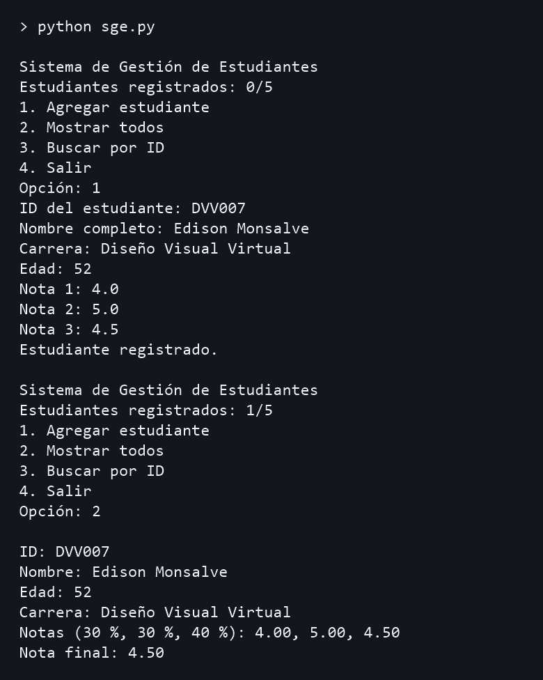

### Listado de cinco estudiantes

En una nueva ejecución se registró a Edison y a cuatro estudiantes ficticios. El listado mostró las cinco fichas y el contador llegó a 5/5. Se aceptaron las edades límite de 15 y 90 y las notas de 0.0 y 5.0.

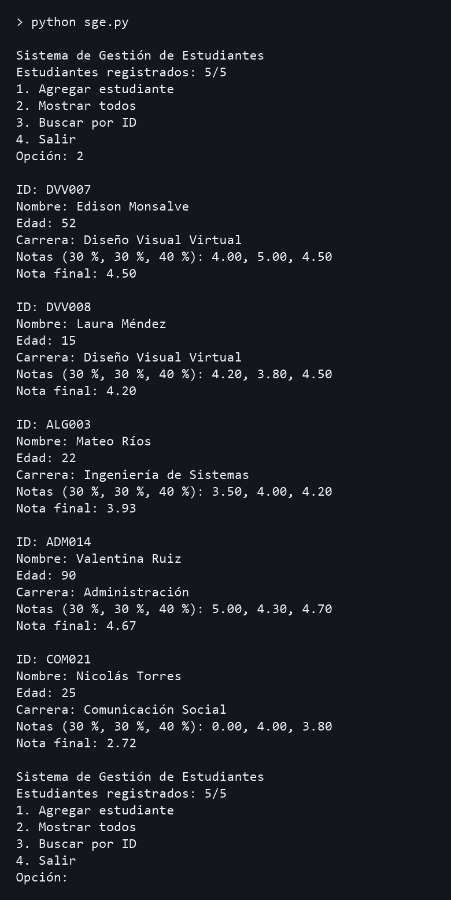

### Opción de menú inválida

Se ingresó la opción 9. El programa mostró un mensaje y volvió al menú.

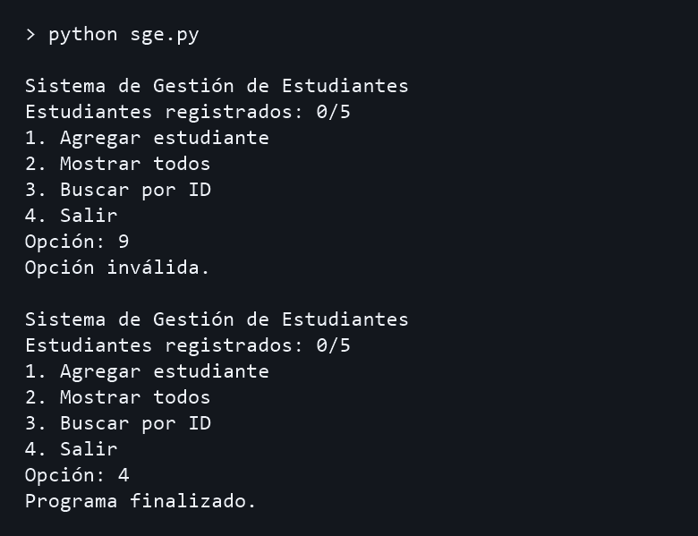

### ID con caracteres inválidos

Se ingresó DVV-007. El guion no es alfanumérico y el contador se mantuvo en 0/5.

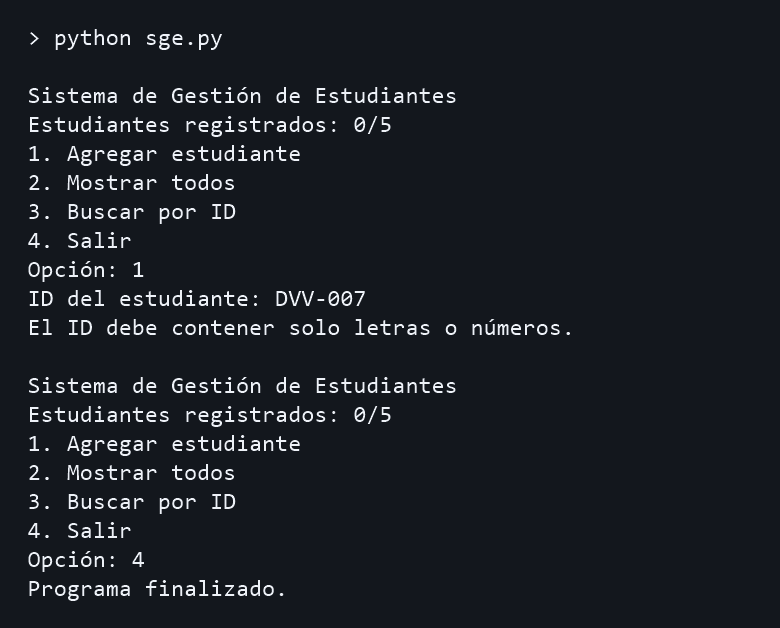

### ID repetido

Después de registrar DVV007 se intentó agregar dvv007. El sistema reconoció el mismo ID y conservó el total en 1/5.

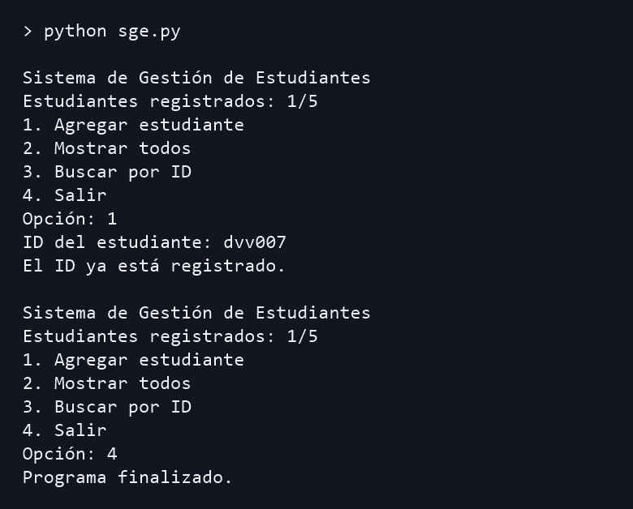

### Nombre vacío

Se dejó el nombre vacío. El sistema indicó que el nombre y la carrera son obligatorios y conservó el total en 0/5.

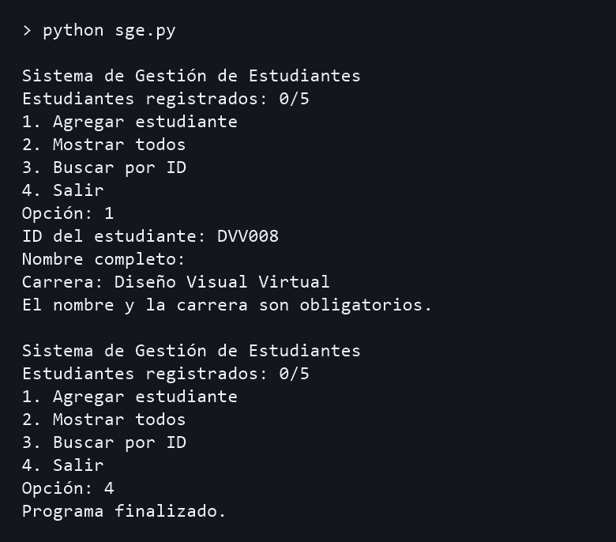

### Carrera vacía

Se dejó la carrera vacía. El sistema mostró el mismo mensaje de campos obligatorios y conservó el total en 0/5.

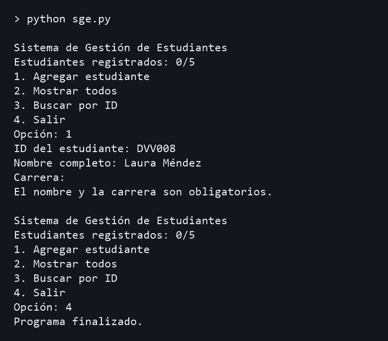

### Edad ingresada como texto

Se escribió «quince». El programa pidió un número entero y conservó el total en 0/5.

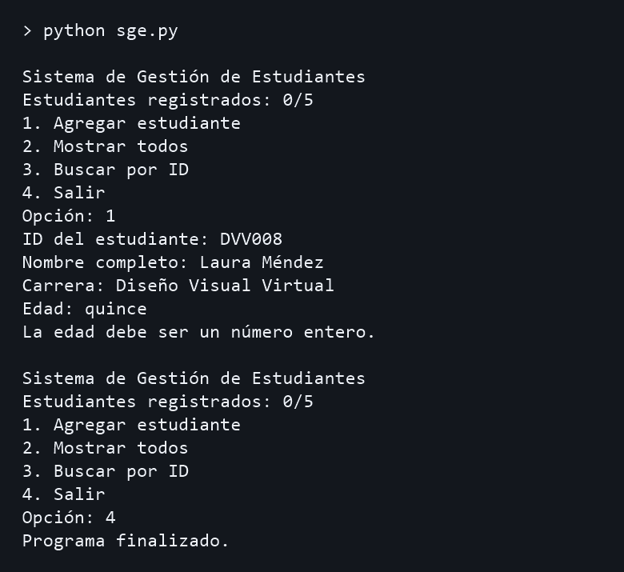

### Edad fuera de rango

Se ingresaron 14 años. El programa indicó el rango de 15 a 90 y conservó el total en 0/5.

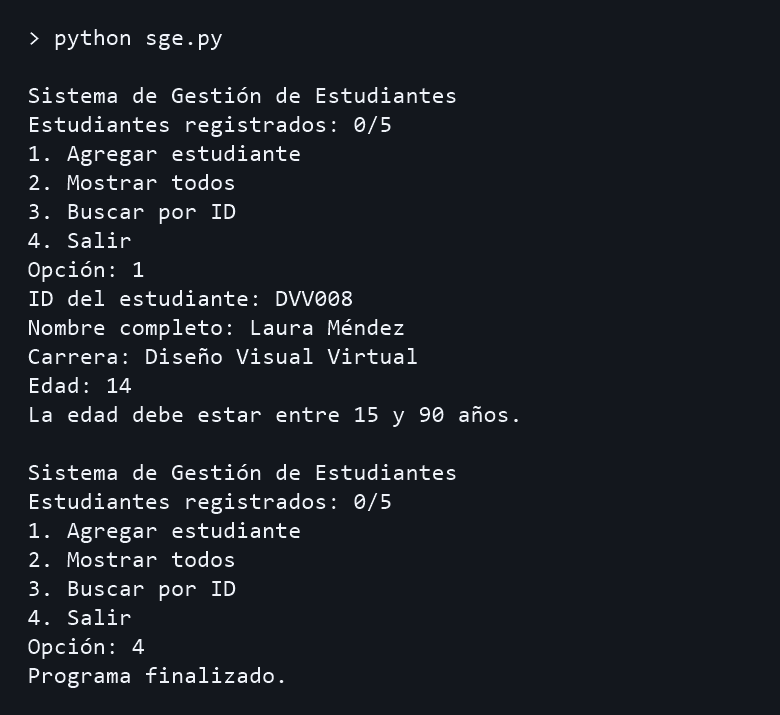

### Nota ingresada como texto

Se escribió «cuatro» en la segunda nota. Se rechazó el registro y el contador siguió en 0/5.

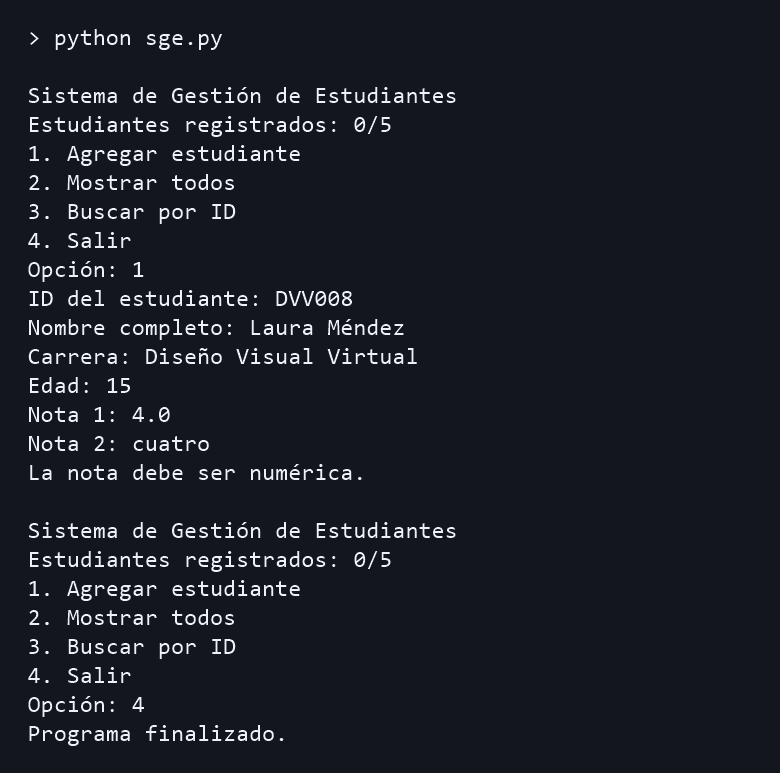

### Nota fuera de rango

Se ingresó 5.1 en la tercera nota. Se rechazó el registro y el contador siguió en 0/5.

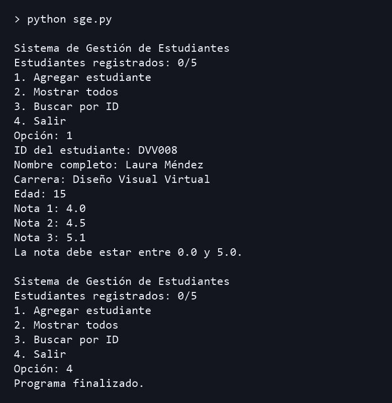

### Cupo alcanzado

Con 5/5 registros se eligió Agregar otra vez. El programa informó que el cupo estaba lleno antes de pedir un ID.

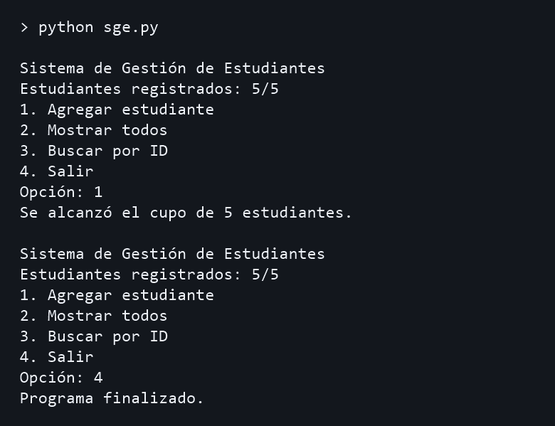

### Listado vacío

Se eligió Mostrar todos al iniciar. El programa informó que todavía no había registros.

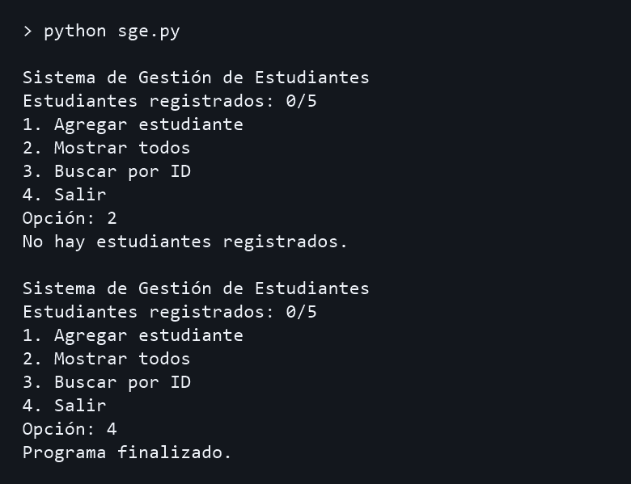

### Búsqueda exitosa

Se buscó dvv007 y se mostró la ficha de Edison con nota final 4.50.

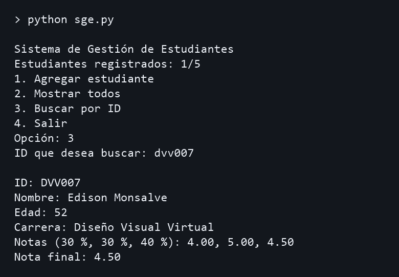

### Búsqueda sin coincidencia

Se buscó DVV999 con un registro en memoria. El programa informó que no encontró el ID y conservó el contador en 1/5.

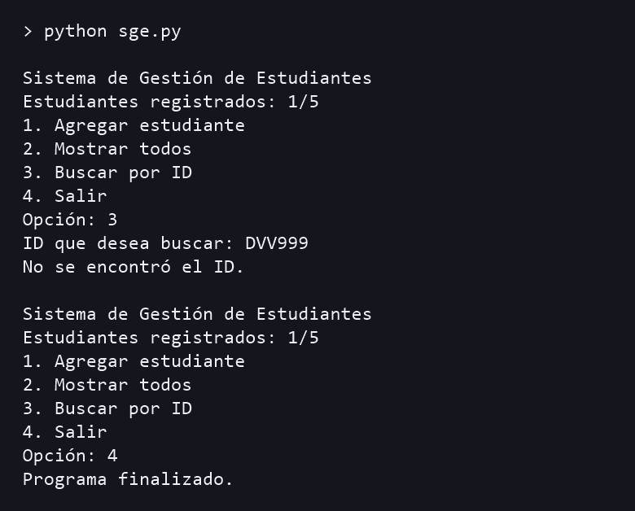

### Salida del sistema

Se eligió la opción 4. Se mostró el mensaje de salida y el programa terminó.

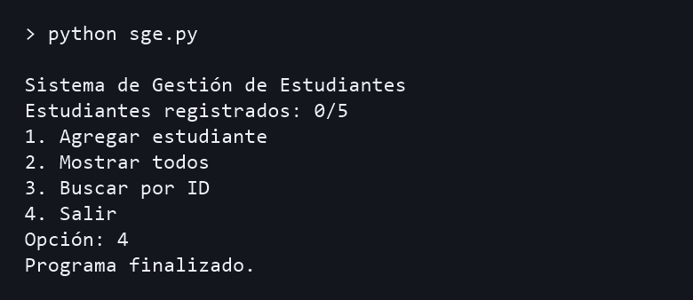

## Anexo. Código fuente

```python
# Sistema de Gestión de Estudiantes (SGE) básico
# Edison Monsalve | ALGORITMOS Y PROGRAMACIÓN
#
# El programa permite agregar hasta cinco estudiantes, mostrar la lista
# y buscar una ficha por su ID. La lista se crea vacía cada vez que se abre
# el programa y los datos se pierden al salir.
#
# Primero están las funciones que usa el menú. Al final está main(),
# que muestra las opciones y controla cuándo termina el programa.
#
# Ejemplo: para DVV007, las notas 4.0, 5.0 y 4.5 dan una nota final
# de 4.50 con pesos de 30 %, 30 % y 40 %.


# Esta búsqueda sirve para consultar una ficha y para revisar IDs repetidos.
def buscar_estudiante(estudiantes, identificacion):
    for estudiante in estudiantes:
        if estudiante["id"] == identificacion:
            # El ID es único, así que podemos dejar de buscar al encontrarlo.
            return estudiante
    # None indica que recorrimos toda la lista sin encontrar el ID.
    return None


# Uso la misma forma de mostrar la ficha en el listado y en la búsqueda.
def mostrar_estudiante(estudiante):
    print(f"\nID: {estudiante['id']}")
    print(f"Nombre: {estudiante['nombre']}")
    print(f"Edad: {estudiante['edad']}")
    print(f"Carrera: {estudiante['carrera']}")
    nota1, nota2, nota3 = estudiante["notas"]

    # Nota para mí
    # En esa notación {nota1:.2f} al principio no me salía, pero en la documentación y lo que salía con IA parecía que si, 
    # finalmente parecía que tuve un error con espacios o algo.
    print(f"Notas (30 %, 30 %, 40 %): {nota1:.2f}, {nota2:.2f}, {nota3:.2f}")
    print(f"Nota final: {estudiante['nota_final']:.2f}")


def agregar_estudiante(estudiantes, contador):
    # Reviso el cupo antes de pedir los datos para evitar escribir una
    # ficha que no se puede guardar.
    if contador >= 5:
        print("Se alcanzó el cupo de 5 estudiantes.")
        return

    # strip() quita los espacios de los extremos. upper() hace que
    # Voy a usar esas funciones para mejorar el tema
    # "dvv007" y "DVV007" se comparen como el mismo ID.
    identificacion = input("ID del estudiante: ").strip().upper()
    if not identificacion.isalnum():
        print("El ID debe contener solo letras o números.")
        return
    if buscar_estudiante(estudiantes, identificacion) is not None:
        print("El ID ya está registrado.")
        return

    # Al quitar los espacios de los extremos, un nombre que contiene
    # solo espacios también queda vacío.
    nombre = input("Nombre completo: ").strip()
    carrera = input("Carrera: ").strip()
    if not nombre or not carrera:
        print("El nombre y la carrera son obligatorios.")
        return

    # input() entrega texto. Si int() no puede convertirlo, except
    # muestra el aviso y return devuelve el control al menú.
    try:
        edad = int(input("Edad: "))
    except ValueError:
        print("La edad debe ser un número entero.")
        return
    if not 15 <= edad <= 90:
        print("La edad debe estar entre 15 y 90 años.")
        return

    # Pido las tres notas con un ciclo porque todas tienen el mismo rango.
    # Si alguna falla, todavía no se ha guardado la ficha del estudiante.
    notas = []
    for numero in range(1, 4):
        try:
            # Acepto tanto 4,5 como 4.5 para escribir un decimal.
            nota = float(input(f"Nota {numero}: ").replace(",", "."))
        except ValueError:
            print("La nota debe ser numérica.")
            return
        if not 0 <= nota <= 5:
            print("La nota debe estar entre 0.0 y 5.0.")
            return
        notas.append(nota)

    # Multiplico cada nota por su peso en decimal y sumo los resultados.
    # La tercera nota tiene más peso porque vale el 40 %.
    nota_final = notas[0] * 0.30 + notas[1] * 0.30 + notas[2] * 0.40

    # Guardo todos los datos en un diccionario para que cada estudiante
    # tenga su propia ficha. Solo la agrego cuando los datos son válidos.
    estudiantes.append({
        "id": identificacion,
        "nombre": nombre,
        "edad": edad,
        "carrera": carrera,
        "notas": notas,
        "nota_final": nota_final,
    })
    print("Estudiante registrado.")


def main():
    estudiantes = []
    contador = 0
    salir = False

    # La bandera empieza en False para mostrar el menú al menos una vez.
    # Cuando cambia a True, el while termina al revisar su condición.
    while not salir:
        print("\nSistema de Gestión de Estudiantes")
        print(f"Estudiantes registrados: {contador}/5")
        print("1. Agregar estudiante")
        print("2. Mostrar todos")
        print("3. Buscar por ID")
        print("4. Salir")
        opcion = input("Opción: ").strip()

        # input() devuelve texto, por eso las opciones se comparan con
        # "1", "2", "3" y "4". case _ recibe cualquier otra entrada.
        match opcion:
            case "1":
                agregar_estudiante(estudiantes, contador)
                # Si agregar falla, la lista sigue igual. Al consultar su
                # tamaño, el contador solo refleja las fichas guardadas.
                contador = len(estudiantes)
            case "2":
                if contador == 0:
                    print("No hay estudiantes registrados.")
                else:
                    for estudiante in estudiantes:
                        mostrar_estudiante(estudiante)
            case "3":
                # Aplico el mismo formato que al guardar el ID para poder
                # encontrarlo aunque el usuario escriba en minúsculas.
                identificacion = input("ID que desea buscar: ").strip().upper()
                estudiante = buscar_estudiante(estudiantes, identificacion)
                if estudiante is None:
                    print("No se encontró el ID.")
                else:
                    mostrar_estudiante(estudiante)
            case "4":
                print("Programa finalizado.")
                salir = True
            case _:
                print("Opción inválida.")


# Este bloque arranca el menú al ejecutar el archivo directamente.
if __name__ == "__main__":
    main()
```
